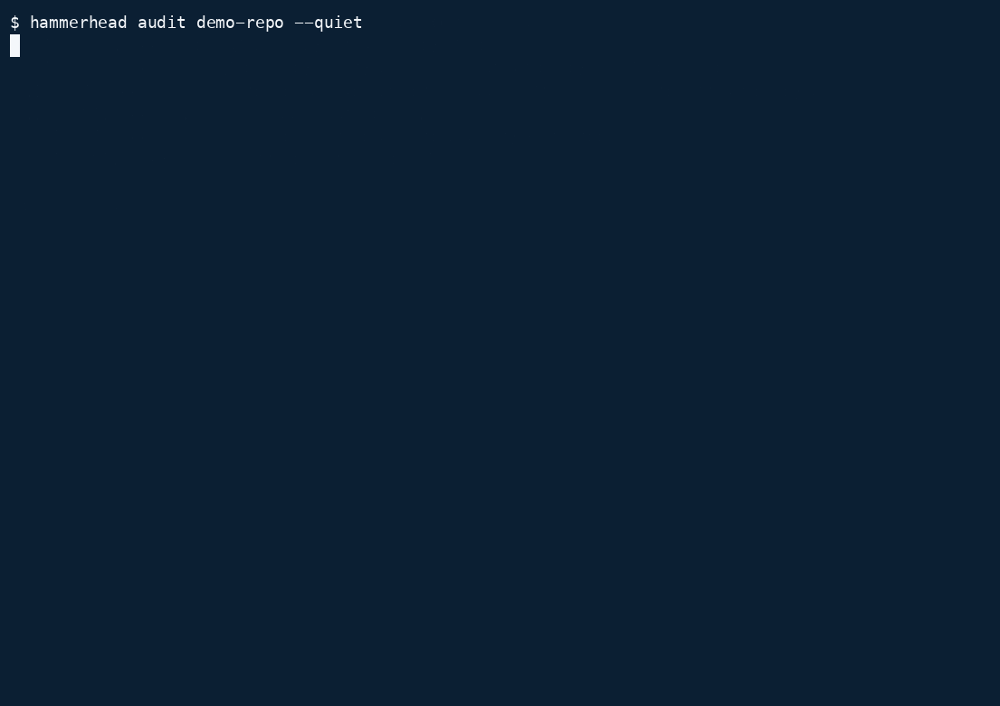

<p align="center">
  <picture>
    <source media="(prefers-color-scheme: dark)" srcset="docs/assets/header-white.svg">
    <source media="(prefers-color-scheme: light)" srcset="docs/assets/header-navy.svg">
    
  </picture>
</p>

<p align="center"><strong>Repository security, sharply focused.</strong></p>

<p align="center">A read-only CLI for auditing potentially untrusted repositories for security findings, hygiene issues, and project context.</p>

<p align="center">
  <a href="https://github.com/ammaarrehman/hammerhead/releases/tag/v0.1.0"></a>
  <a href="go.mod"></a>
  <a href="LICENSE"></a>
</p>

<p align="center">
  
</p>
<p align="center"><sub>Real Hammerhead v0.1.0 run on synthetic fixtures. No usable credentials.</sub></p>

## Why Hammerhead

- Audit the current working tree locally, without executing its build scripts or package managers.
- Identify sensitive filenames and supported credential patterns, alongside repository hygiene issues.
- Keep Security, Hygiene, and Info findings separate; only Security findings affect the failure threshold.
- Use readable terminal reports or structured JSON in scripts and automation.

## Installation

For the current development source:

```sh
git clone --branch v0.2-dev https://github.com/talarurus/hammerhead.git
cd hammerhead
go build ./cmd/hammerhead
./hammerhead version
```

The active Go module is `github.com/talarurus/hammerhead`. The historical `v0.1.0` tag retains `github.com/ammaarrehman/hammerhead`; that release cannot be installed using the new module path. The downloads and demo below describe v0.1.0. Current source defaults to `0.2.0-dev`; this foundation work does not publish or declare a v0.2 release.

### Historical v0.1.0 release

Download the archive for your platform from the [v0.1.0 release](https://github.com/ammaarrehman/hammerhead/releases/tag/v0.1.0):

| Platform | Archive |
| --- | --- |
| macOS, Apple Silicon | [darwin_arm64](https://github.com/ammaarrehman/hammerhead/releases/download/v0.1.0/hammerhead_0.1.0_darwin_arm64.tar.gz) |
| macOS, Intel | [darwin_amd64](https://github.com/ammaarrehman/hammerhead/releases/download/v0.1.0/hammerhead_0.1.0_darwin_amd64.tar.gz) |
| Linux, arm64 | [linux_arm64](https://github.com/ammaarrehman/hammerhead/releases/download/v0.1.0/hammerhead_0.1.0_linux_arm64.tar.gz) |
| Linux, amd64 | [linux_amd64](https://github.com/ammaarrehman/hammerhead/releases/download/v0.1.0/hammerhead_0.1.0_linux_amd64.tar.gz) |

Compare the archive's SHA-256 with the release's [checksums.txt](https://github.com/ammaarrehman/hammerhead/releases/download/v0.1.0/checksums.txt), extract it, and put the `hammerhead` executable on your `PATH`. Verify the installed release:

```sh
hammerhead version
```

## Development v0.2 quick start

The following commands use the development binary on your `PATH`:

```sh
hammerhead audit .
hammerhead audit . --quiet
```

Terminal reports show completion status and coverage before any “No findings” message. Quiet mode keeps compact findings on stdout and sends status, coverage and necessary diagnostics to stderr, including zero-findings scans. JSON stdout is one `hammerhead/v0.2` document; operational messages go to stderr. Output write/short-write/flush failures exit 2, overriding findings. On Unix the executable ignores SIGPIPE so a broken stdout or stderr pipe returns operational exit 2; delivery is best effort. See [the output contract](docs/contracts/OUTPUT.md).

## Example findings

This table comes from an actual v0.1.0 run on the separate synthetic demo repository. The PEM placeholder is not a usable key. Matching a key header or filename does not verify a real credential or prove it was committed.

| Check | Class | Severity | Actual finding |
| --- | --- | --- | --- |
| FILE-001 | Security | High | Private key file: `certs/demo.key` |
| SEC-001 | Security | High | Cryptographic private key in file content: `certs/demo.key:1` |
| GIT-001 | Hygiene | Low | Sensitive pattern missing from `.gitignore`: Private keys |
| PROJ-001 | Hygiene | Low | Missing project LICENSE |
| GIT-002 | Info | Info | Uncommitted changes in repository worktree |
| PROJ-002 | Info | Info | Project runtime: Go |

The run produced six findings, security risk `high`, and exit status `1`. The same file can produce more than one finding from different checks.

## Development v0.2 JSON and automation

Reports include `status`, `threshold`, `summary`, `findings`, applied policy and observed work in `coverage`, and safe typed `diagnostics`. Coverage is not a percentage of repository safety. Counts describe observed work; incomplete results can retain findings without establishing absence elsewhere.

| Scan status | Meaning | Exit |
| --- | --- | --- |
| `completed` | Applicable required work finished within declared scope | 0, or 1 when a Security finding meets the threshold |
| `partial` | Required traversal, read, check, Git operation or production budget was incomplete | 2 |
| `failed` | Setup/root establishment failed | 2 |
| `cancelled` | Cancellation or deadline interrupted the audit | 2 |

Invalid requests and report failures also exit 2. Setup failures may have no report; a failed write may leave incomplete JSON. `--fail-on none` suppresses only finding exit 1. Hygiene and Info never trigger exit 1. Completed exit 0 establishes completion within policy, not perfect detection or safety.

Keep reports outside the audited tree and preserve Hammerhead's exit status:

```sh
report_dir=$(mktemp -d)
if hammerhead audit . --output json > "$report_dir/audit.json"; then
  audit_status=0
else
  audit_status=$?
fi
# Operational failures may still have useful partial JSON; parse it if complete.
if jq '{schema, version, status, threshold, summary, coverage}' "$report_dir/audit.json"; then
  printf 'Report: %s\n' "$report_dir/audit.json"
else
  printf 'No complete JSON report was delivered.\n' >&2
fi
exit "$audit_status"
```

The historical v0.1.0 release uses `hammerhead/v0.1`, does not expose traversal skips in JSON, and could record check errors without forcing exit 2. These legacy semantics do not describe development v0.2. There is no legacy serializer; see [migration notes](docs/MIGRATING-TO-V0.2.md) and [the JSON contract](docs/contracts/JSON-V0.2.md).

Useful audit options:

| Option | Behavior |
| --- | --- |
| `--output json` / `-o json` | Structured JSON; default output is terminal |
| `--quiet` / `-q` | Compact findings on stdout; status/coverage/diagnostics on stderr |
| `--fail-on medium` | Fail on Security findings of medium severity or higher |
| `--exclude certs` / `-e certs` | Exclude a path or matching pattern; repeatable |
| `--max-file-size 10MB` | Override FILE-002's large-file threshold |
| `--help` / `-h` | Actual command help |

`--max-file-size` changes only FILE-002’s threshold; it does not change the 10 MiB guarded-read bound, SEC-001’s 5 MiB eligibility or the 256 MiB aggregate read budget. Run `hammerhead audit --help` for command syntax.

## Native checks

These seven checks originate in v0.1.0 and remain the development rule inventory. Wording describes observations, never verified credential validity, pairing, commitment or exposure. See [rules](docs/contracts/RULES.md) and [reviewed claims](docs/contracts/CLAIMS.md).

| Check | Class | Purpose |
| --- | --- | --- |
| FILE-001 | Security | Sensitive filenames, including private keys and credential configuration files |
| FILE-002 | Hygiene | Files exceeding the large-file threshold: 50 MiB by default |
| GIT-001 | Hygiene | Missing ignore patterns for supported sensitive file groups |
| GIT-002 | Info | Git worktree state |
| PROJ-001 | Hygiene | Missing README or LICENSE |
| PROJ-002 | Info | Runtime/package-manifest detection |
| SEC-001 | Security | Supported PEM private-key headers and AWS credential patterns in readable text |

## Development security model

Native checks consume a bounded inventory and one guarded reader; binary probing and content reads use the same verified regular-file handle. Unix descriptor-relative opens validate component identity, reject special files and enforce root/exclusion boundaries. Supported relative in-root file symlinks remain usable; directory symlinks, absolute links and aliases into excluded targets are rejected. User-selected root aliases are resolved before pinning. Hard links, mounts and arbitrary hostile kernel/filesystem behavior are outside a blanket containment guarantee.

Traversal limits are depth 50, 100,000 retained entries and 100,000 examined entries, directory batches of 256 and 10,000 names per directory. Oversized directories discard the unprocessed child set rather than select a nondeterministic prefix. Finding production stops after 10,000 retained findings and the next attempted emission; string and diagnostic budgets apply at producers. See [all budgets and residual limits](docs/contracts/SCAN-RESULT.md).

Git is an optional, separately bounded installed executable. Hooks/fsmonitor configuration are disabled and `GIT_OPTIONAL_LOCKS=0` suppresses optional writes. Missing Git is visibly `unavailable`; native checks can complete. Ordinary non-Git directories and audited subdirectories are `not_applicable`. Available Git failure/timeout/output overflow makes the scan partial; no raw HEAD fallback or raw Git stderr is exposed. Git may read external worktree metadata, separately from native content confinement.

Run as an ordinary user on supported macOS/Linux systems. These are defense-in-depth measures, not an OS sandbox, whole-process memory cap, credential validator or guarantee that hostile repositories are harmless. Cancellation is cooperative between bounded local operations; uninterruptible kernel, FUSE or network filesystem I/O can exceed the CLI’s five-minute context deadline.

## Limitations

- Scans the current working tree, not Git history.
- Matches supported patterns; it does not validate whether credentials are active or detect every token format.
- Does not provide CVE/dependency database scanning or semantic SAST/data-flow analysis.
- Does not unpack archives; binary and oversized content is outside normal secret-content inspection.
- A successful threshold result is not a clean bill of health.

## Contributing

Use issues for ordinary bugs and focused feature requests, and pull requests for improvements. For vulnerabilities, follow the private route below.

Development requires Go 1.26.0 or newer; use a supported patch release (G12 validation uses 1.26.9 and current Go 1.27.2). Git is needed for real Git fixture tests. Existing checks include:

```sh
make test
make vet
```

`make test` runs the Go tests with race detection. Keep fixtures synthetic and do not submit real credentials. Describe changes and how you verified them. [CONTRIBUTING.md](CONTRIBUTING.md) records the native CI matrix, local arm64 validation and compile-only targets.

## Security reporting

Follow [SECURITY.md](SECURITY.md) for private reporting and supported versions. Do not report vulnerabilities, active exploits, or actual credential exposures through public issues.

## License

Hammerhead is licensed under [Apache 2.0](LICENSE).
